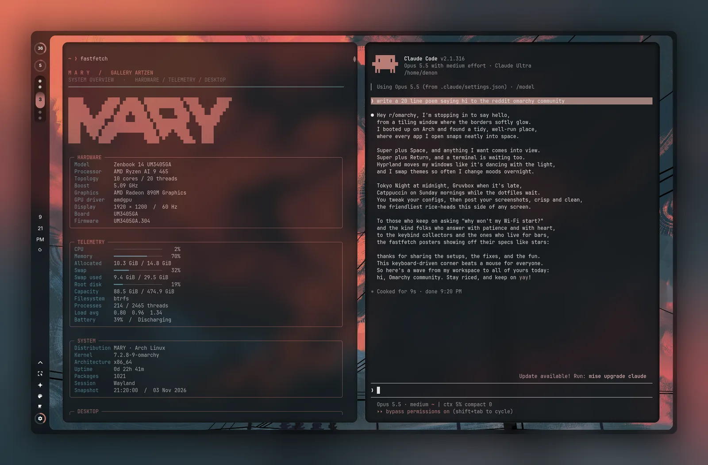
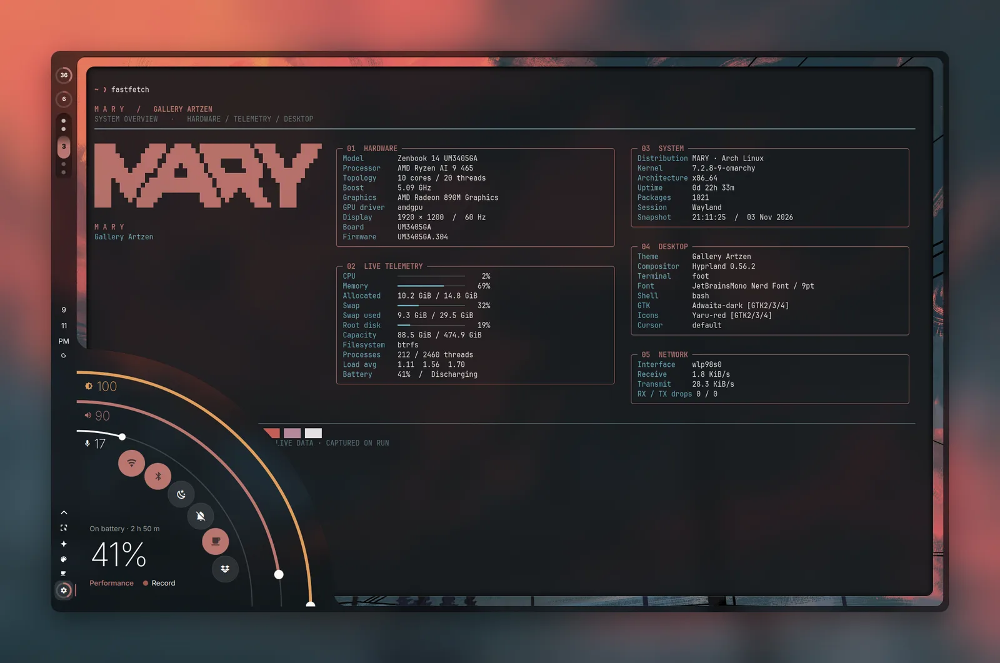
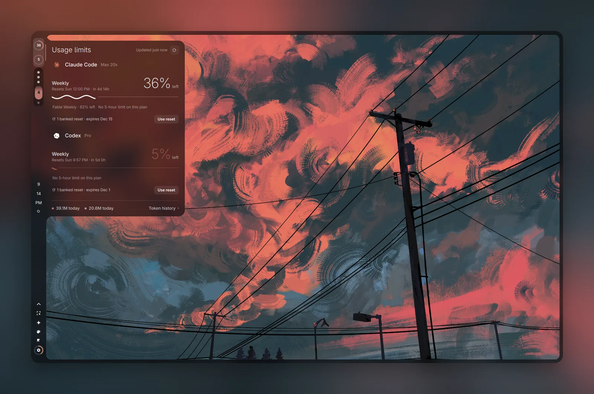
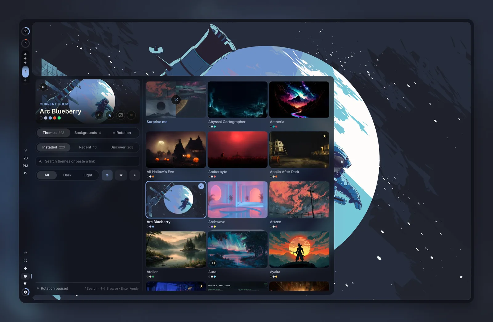
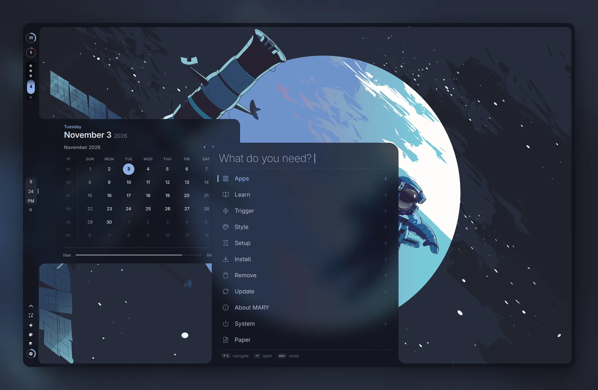

# omarchy-dots

My Omarchy setup: a frosted left rail that wraps the screen as one surface, a quarter-circle control corner, a search-first menu, recessed windows, and a fastfetch dashboard. Built on [Omarchy](https://omarchy.org) 4.

Most of it was made by describing what I wanted to Claude Code, having it show me ten or more takes, then iterating on the one I liked.



<table>
<tr>
<td width="50%"></td>
<td width="50%"></td>
</tr>
<tr>
<td width="50%"></td>
<td width="50%"></td>
</tr>
</table>

<sub>Themes: Artzen and Arc Blueberry. The screenshots show my own name ("MARY") set as the menu and fastfetch title; a fresh install says OMARCHY until you <a href="#make-it-yours">set yours</a>. The usage drawer's banked-reset button ships for Codex only; the Claude one in the screenshot isn't included.</sub>

## What's in it

**Shell and bar**

| Plugin | What it does |
|---|---|
| `denon.shell` | Pebble Shell: the left rail and screen frame as one frosted surface. This is the bar. |
| `denon.bar` | Shared drawer and motion code the other panels use (also works as a floating pill bar on its own). |
| `denon.corner` | Quarter-circle drawer out of the rail's bottom corner: brightness, volume, mic, toggles, battery. |
| `denon.menu` | Search-first desktop menu (Super + Space). |
| `denon.studio` | One drawer for the look: Glass, Depth, Tricky Tiles and display. |
| `denon.glass` | Opacity, blur and backdrop controls. |
| `denon.recess` | Depth: recessed or raised windows, tuned separately for light and dark themes. |
| `denon.workspaces`, `denon.clock`, `denon.weather`, `denon.tray`, `denon.indicators` | Restyled bar widgets. |

**Panels and system UI**

| Plugin | What it does |
|---|---|
| `denon.audio`, `denon.network`, `denon.bluetooth`, `denon.power`, `denon.monitor`, `denon.touchpad` | Drawers for sound, Wi-Fi, Bluetooth, power, display and touchpad. |
| `denon.notifications`, `denon.osd`, `denon.polkit`, `denon.battery` | Notifications, on-screen display, password prompt and low-battery warning, restyled to match. |
| `denon.agents` | Claude Code and Codex usage limits in the bar. Uses your own signed-in CLIs. |
| `denon.dropbox` | Dropbox sync status. Only useful if you use Dropbox. |

**Installed from their own repos** by `install.sh`:

- [Hello Lock](https://github.com/denonmaryland/hello-lock): the lock screen.
- [Theme Studio](https://github.com/denonmaryland/omarchy-theme-studio): the theme and wallpaper picker.
- [Tricky Tiles](https://github.com/denonmaryland/omarchy-tricky-tiles): smoother window and workspace motion with trackpad swipes.
- [Softly](https://github.com/denonmaryland/omarchy-softly): tap a key, speak, tap again. Local Whisper dictation through [Voxtype](https://voxtype.io).

**Config**

- `hypr/`: scrolling (carousel) layout, rounded corners, macOS-style animations, blur rules for the shell, keybindings, natural scrolling, four-finger Brave tab swipes.
- `fastfetch/`: the dashboard-style fastfetch.
- `foot/`: terminal config.

## Themes

The screenshots use two themes. Their wallpapers come with them.

- **Artzen** by tahfizhabib: `omarchy theme install https://github.com/tahfizhabib/omarchy-artzen-theme`
- **Arc Blueberry** by vale-c: `omarchy theme install https://github.com/vale-c/omarchy-arc-blueberry`

## Install

You need a working Omarchy 4 install.

```bash
git clone https://github.com/denonmaryland/omarchy-dots
cd omarchy-dots
./install.sh
```

The script lists what it will change and asks once. Everything it replaces is copied to `~/.config/omarchy-dots-backup/<time>/` first. It never touches `hypr/monitors.lua`.

Then log out and back in, or run `hyprctl reload && omarchy restart shell`.

### Optional apps

These are wired up if they're installed and skipped if not:

- **Snip** for screenshots and recording (Super + Ctrl + 3/4, Alt + Print).
- **flea** as the file manager (Super + Shift + F).
- **Voxtype** for Softly dictation.
- **Brave** for the four-finger tab swipes.

## Make it yours

**Name.** The menu title and the fastfetch heading read one setting. Add this to `~/.config/omarchy/extensions/omarchy-menu.jsonc`:

```jsonc
{
  "root": { "label": "Pixel", "title": "PIXEL" }
}
```

Without it, both say OMARCHY. The big fastfetch logo is Omarchy's own `~/.config/omarchy/branding/about.txt`, so replace that file to change the logo.

**Bar layout.** `~/.config/omarchy/shell.json` decides which widgets sit where. Remove any you don't want (for example `denon.dropbox` or `denon.agents`).

**Look.** Open the Studio drawer in the bar to change glass, depth and motion. Its panels write `hypr/glass.lua` and `hypr/recessed_windows.lua` for you.

## Undo

Copy the files from `~/.config/omarchy-dots-backup/<time>/` back into your home folder, then run `hyprctl reload && omarchy restart shell`. To drop a single plugin: `omarchy plugin disable <id>`.

## Notes

- Built and used on one laptop (Zenbook 14, Omarchy 4.0.6, single screen). Multiple monitors are untested.
- The Touchpad drawer finds your touchpad automatically. If it picks the wrong one, set `TOUCHPAD_DEVICE` to the name shown by `hyprctl devices`.
- `denon.agents` replaces Omarchy's Codex usage reader with one that fixes a read timeout. Remove `~/.local/bin/denon-agent-usage-update` to go back to the stock reader.

## Credits

- Most panels started as clones of Omarchy's built-in plugins (`omarchy plugin clone`). Omarchy is MIT licensed; see [THIRD_PARTY_NOTICES.md](THIRD_PARTY_NOTICES.md).
- Icons in `denon.menu/icons` and `denon.tray/icons` are from [Lucide](https://lucide.dev) (ISC).
- Themes and wallpapers belong to their creators.

## License

MIT. See [LICENSE](LICENSE).
